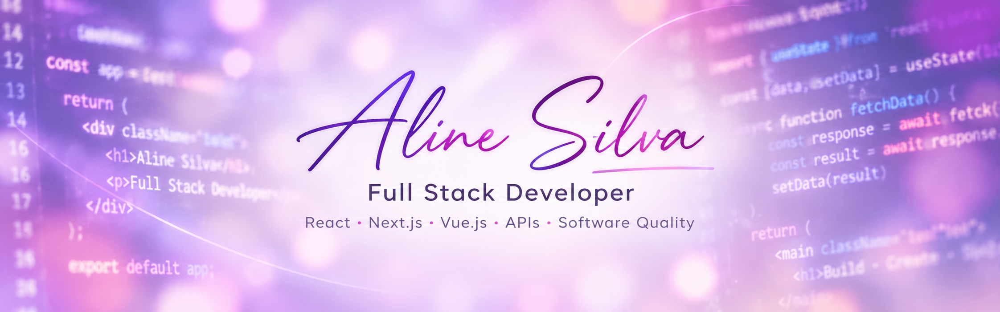

  

 

# Olá, eu sou Aline Silva 👋

**Full Stack Developer | React · Next.js · TypeScript · Vue.js · Node.js · Laravel**

Sou desenvolvedora Full Stack com experiência na construção, evolução e manutenção de aplicações web, atuando desde interfaces modernas e acessíveis até APIs, integrações, regras de negócio e bancos de dados.

Ao longo da minha trajetória, participei de projetos de diferentes portes e segmentos, incluindo **logística, energia, arquitetura e construção, plataformas digitais e sistemas corporativos**.

Tenho experiência com **React, Next.js, Vue.js, JavaScript, TypeScript, Node.js, Laravel e PHP**, além de bancos de dados relacionais e não relacionais, APIs REST, AWS e WordPress.

Também atuo com **qualidade de software**, testes funcionais e automação com Cypress e Vitest, além de utilizar inteligência artificial como apoio ao desenvolvimento, revisão de código e criação de cenários de teste.

## Conexões

  <a href="https://www.linkedin.com/in/alinejesus/" target="_blank">LinkedIn</a> •
  <a href="https://www.behance.net/alinejesus" target="_blank">Behance</a> •
  <a href="https://trampos.co/aline-silva" target="_blank">Trampos.co</a> •
  <a href="https://github.com/AlineJesus" target="_blank">GitHub</a>

## Tecnologias

### Frontend
React · Next.js · Vue.js · JavaScript · TypeScript · HTML5 · CSS3 · Tailwind CSS · Styled Components · Bootstrap · Vite

### Backend e APIs
Node.js · PHP · Laravel · APIs REST · Strapi · WordPress

### Dados e infraestrutura
MySQL · PostgreSQL · SQL Server · MongoDB · Redis · AWS · Docker

### Qualidade
Cypress · Vitest · Testes E2E · Testes Funcionais · QA Manual · Code Review · IA aplicada ao desenvolvimento e testes

### Práticas
Git · GitHub · Scrum · Integrações entre sistemas · Desenvolvimento orientado a componentes · Refatoração · Manutenção de sistemas

## Projetos e experiências em destaque

### 🚚 Sistema de gestão logística

Atuação em uma plataforma de **gerenciamento de estoque, cálculo de frete e controle de cargas e entregas**.

O sistema utilizava integração com serviço de **geolocalização** para apoiar cálculos e gerenciamento do processo logístico, proporcionando experiência prática com regras de negócio, consumo de APIs e sistemas de gestão.

### ☀️ Plataforma do setor de energia

Participação desde as etapas iniciais de evolução de uma plataforma digital do setor de energia.

Atuei principalmente no frontend, incluindo:

- desenvolvimento e validação de novos perfis de usuário;
- implementação e evolução de funcionalidades;
- refatoração do frontend após mudanças na arquitetura de dados;
- validação de comportamentos e regras de acesso.

Essa experiência ampliou meu contato com aplicações que precisavam evoluir mantendo funcionalidades já existentes.

### ♿ Aplicação voltada à acessibilidade

Desenvolvimento de uma aplicação com foco em **acessibilidade para pessoas com deficiência auditiva e baixa visão**.

O projeto envolveu construção de interfaces, experiência do usuário e atenção a requisitos de acessibilidade, sendo uma das experiências que mais contribuíram para minha visão sobre desenvolvimento inclusivo.

### 🏗️ Plataforma para Arquitetura, Engenharia e Construção

Na **Kuara**, participei do desenvolvimento de uma aplicação de grande porte voltada ao setor de **Arquitetura, Engenharia e Construção (AEC)**.

**Frontend:** Vue.js · Vite · Three.js  
**Backend / infraestrutura:** Node.js · MongoDB · AWS

Foi uma experiência importante no meu desenvolvimento profissional, especialmente pelo contato mais aprofundado com **AWS, arquitetura de aplicações de maior porte e integração entre diferentes camadas do sistema**.

O projeto também ampliou minha experiência com aplicações que exigem escalabilidade e manipulação de informações mais complexas.

### 🔗 Plataformas digitais, APIs e integrações

Atuação em aplicações Full Stack envolvendo:

- APIs REST;
- integração com serviços externos;
- regras de negócio;
- processamento e validação de dados;
- bancos de dados relacionais;
- manutenção e evolução de sistemas em produção.

Parte dos projetos profissionais em que atuo possui código e informações privadas pertencentes às empresas contratantes.

### 🧪 Qualidade e automação

Experiência com testes manuais em aplicações web e evolução para automação de cenários com **Cypress e Vitest**.

Tenho utilizado inteligência artificial como apoio em atividades como:

- criação e revisão de cenários de teste;
- análise e revisão de código;
- investigação de possíveis regressões;
- documentação técnica;
- apoio à automação de processos de desenvolvimento.

### 🌐 Desenvolvimento web e WordPress

Minha trajetória também inclui desenvolvimento de sites institucionais, landing pages, e-commerce e soluções personalizadas em WordPress.

Alguns trabalhos e projetos podem ser encontrados no meu:

<a href="https://www.behance.net/alinejesus">Behance</a> e
<a href="https://trampos.co/aline-silva">perfil profissional no Trampos.co</a>.

## Experiência profissional

- **Pyxys Inteligência Digital** — Desenvolvedora Full Stack
- **Kuara Tec LTDA** — Desenvolvedora Full Stack
- **Quiker** — Desenvolvedora Full Stack
- **App4you Aplicativos** — Desenvolvedora Full Stack
- **Levantti** — Desenvolvedora Full Stack

Minha experiência envolve desenvolvimento e manutenção de aplicações web, APIs, integrações, sistemas de gestão, bancos de dados, interfaces responsivas e evolução de sistemas existentes.

## Formação

🎓 **Análise e Desenvolvimento de Sistemas** — Anhanguera *(em andamento)*  
🎓 **Técnico em Informática** — IFBA  
📚 **Formação complementar em React e Next.js** — Alura

## Atualmente

Tenho direcionado meus estudos e projetos para:

- arquitetura e evolução de aplicações Full Stack;
- APIs e integrações entre sistemas;
- qualidade e automação de testes;
- aplicações em nuvem;
- uso de IA no ciclo de desenvolvimento de software.

 

  Full Stack Development • APIs • Integrações • Cloud • Software Quality

